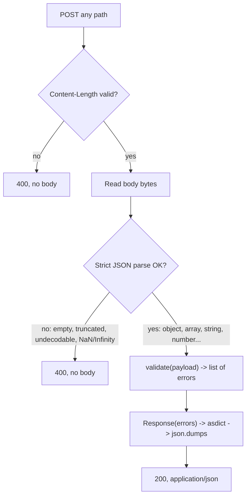

# Validation Response Shape - Plan

## Goal Capsule

- **Objective:** The front-end can build its error display against the real response from `POST /validate-annotations`: a typed, flat list of user-friendly validation errors, empty until the stage 3 rules exist.
- **Means:** Frozen dataclass response types returned as JSON by the existing stdlib handler, which now parses the upload strictly (KTD1, KTD3).
- **Product authority:** This plan covers stage 2 of the annotation-validator prototype only. Stage 3 (the validation rules) and warnings are not active scope.
- **Execution profile:** Two units, U1 then U2; standard library only; existing `unittest` suite.
- **Stop conditions:** Stop and ask if any requirement would need an external dependency, or if strict parsing turns out to reject a fixture file.
- **Open blockers:** None.

---

## Product Contract

**Product Contract preservation:** changed: R7 (strict JSON: `NaN`, `Infinity` and `-Infinity` are rejected, decided by the user during planning), AE6 added; Outstanding Questions resolved in place by KTD1 and KTD2.

### Summary

The endpoint parses the uploaded JSON, calls `validate()`, and returns a typed response holding a flat list of validation errors as JSON. Each error is a frozen `dataclass` carrying a ready-to-display message written by the server. `validate()` still returns an empty list; stage 3 fills it.

### Problem Frame

Stage 1 left a 200-only endpoint and a placeholder `validate()` with no defined return shape. The consumer is a front-end application that shows users friendly errors (and later warnings). If the shape and the rules were designed together in stage 3, the front-end would have nothing real to integrate against until the rules were done, and the rules would be written against a moving target.

Validation errors come in two internal kinds: type errors (a field has the wrong type) and content errors (a value is wrong by itself or in relation to other fields). The fixtures show that the shape must cover records with no usable `id`, errors spanning several records, and several errors on one record (`test/fixtures/extended-import.json`).

### Key Decisions

- **Frozen `dataclass`, not `TypedDict`.** With no external dependencies there is no static type checker to enforce a `TypedDict`, while a dataclass fails at construction on a missing field. Governs R3. (session-settled: user-approved — chosen over `TypedDict`: no type checker runs in a stdlib-only project, so `TypedDict` would be unchecked)
- **The server writes the final message text.** The front-end displays it as-is. Governs R2. (session-settled: user-directed — chosen over front-end-owned wording from codes, and over code plus default message: the front-end should not own error copy)
- **Flat list, no placement metadata.** The message itself identifies the record; several problems on one record are separate entries. Governs R1, R6. (session-settled: user-directed — chosen over errors attached to a record or a field: a flat list is enough for now, and a pointer field can be added later without breaking clients)
- **Type vs content stays internal.** The response carries no kind field. Governs R4. (session-settled: user-directed — chosen over exposing the kind for the front-end or for information: the split organises validator code, not the UI)
- **Records are named by 1-based position only.** One rule covers missing, empty, wrong-type and duplicate `id`s. Governs R5. (session-settled: user-approved — chosen over id-with-position-fallback and over id plus position: simplest single rule; adding the id to the text later does not change the shape)
- **Stage 2 returns the real body.** The front-end can integrate now. Governs R1, R7. (session-settled: user-directed — chosen over defining types only and keeping an empty 200)
- **Malformed JSON is a 400 with no body.** Governs R7. (session-settled: user-directed — chosen over a 200 with one error, and over leaving it undefined: a malformed upload is a bad request, like an invalid `Content-Length`)
- **Strict JSON only.** `NaN`, `Infinity` and `-Infinity` count as malformed. Governs R7. (session-settled: user-directed — chosen over accepting them as Python's parser does by default: strict JSON does not allow them)
- **The list is wrapped in an object, with no `valid` flag.** Wrapping lets warnings arrive later as a sibling list; an empty error list already means the file passed. Governs R1, R4.

### Requirements

**Response shape**

- R1. When the request body is valid JSON, the endpoint returns 200 with a JSON body: an object containing a list of validation errors, which is empty when the file passed.
- R2. Each validation error carries a user-facing message, written by the server and ready to display, and a short stable code that users never see and tests can assert on.
- R3. The error and the response are defined as frozen dataclass types, and `validate()` is typed to return a list of the error type.
- R4. The response carries no type/content kind and no separate pass/fail flag.

**Message and ordering rules (binding on the stage 3 rules)**

- R5. Messages name a record by its 1-based position in its list ("Annotation #59", "Image #4"), never by its `id`.
- R6. Every error found is reported, in the order the records appear in the file.

**Request handling**

- R7. The handler parses the request body as strict JSON before calling `validate()`; a body that is not valid JSON returns 400 with no body, including an empty body, undecodable bytes, and the non-standard values `NaN`, `Infinity` and `-Infinity`.
- R8. Valid JSON that is not an object (for example `[]` or `"hello"`) is not a 400; it reaches `validate()`, whose stage 3 rules report it as a validation error.
- R9. In stage 2, `validate()` returns an empty list for every input.

### Acceptance Examples

- AE1. **Covers R1, R9.** **Given** `test/fixtures/sample-import.json`, **when** it is POSTed, **then** the response is 200 with a JSON body whose error list is empty.
- AE2. **Covers R7.** **Given** a truncated JSON body, **when** it is POSTed, **then** the response is 400 with no body.
- AE3. **Covers R7.** **Given** a POST with no `Content-Length` header, **when** the body is read as empty, **then** the response is 400 with no body (stage 1 returned 200 here).
- AE4. **Covers R8, R9.** **Given** the body `[]`, **when** it is POSTed, **then** the response is 200 with an empty error list in stage 2.
- AE5. **Covers R2, R3.** **Given** an error built with a code and a message inside a response, **when** it is serialized, **then** the JSON holds exactly those values, and building an error without a message fails immediately.
- AE6. **Covers R7.** **Given** a body such as `{"x": NaN}`, `{"x": Infinity}` or `{"x": -Infinity}`, **when** it is POSTed, **then** the response is 400 with no body.

### Scope Boundaries

- Deferred to stage 3: the validation rules, the catalogue of error codes, and the exact message wording.
- Deferred: warnings, machine-readable pointers to records or fields, and adding `id`s to message text.
- Unchanged: the 400 for a malformed or negative `Content-Length`; no routing (any path accepts POST, other methods get the default 501).
- Considered and not built: an upload size limit. The prototype runs locally against fixture-sized files, so reading the whole body into memory is acceptable; a shared or hosted deployment would change that call.
- Considered and not built: a reason in the 400 body. R7 fixes the 400 as bodiless; production support needs (telling encoding, syntax and truncation apart) would change that call.

### Sources / Research

- `test/fixtures/extended-import.json`: annotations #30, #31, #32, #59, #60, #61 and #63 have no usable `id`; images such as `mixed-subsets-ab` exercise errors spanning several records; `extended-059` carries two problems.
- `annotation_validator/server.py`: `Handler._discard_body` reads and drops the body, returns `False` for a malformed or negative `Content-Length`, and treats a missing header as an empty body.
- `docs/plans/2026-11-08-1622-feat-validate-annotations-server-boilerplate-plan.md`: stage 1 plan and the stage list.

---

## Planning Contract

### Key Technical Decisions

- KTD1. **Wire names match field names: `{"errors": [{"code": ..., "message": ...}]}`.** Dataclass field names are the JSON keys, so serialization needs no mapping layer. The response stores its errors as a tuple so that "frozen" holds all the way down; `validate()` still returns a list per R3 and the handler converts it. Covers R1, R2, R3.
- KTD2. **Types live in a new `annotation_validator/response.py`.** `validate.py` imports the error type from there, and the server imports both, so the HTTP layer and the validator share one definition without importing each other. `code` is a plain `str` until stage 3 defines a catalogue.
- KTD3. **Parse with `json.loads` on the raw bytes, plus a `parse_constant` hook that raises `ValueError`.** The hook is called only for `NaN`, `Infinity` and `-Infinity`, so raising there rejects exactly those values. Catching `ValueError` covers the hook's error as well as `JSONDecodeError` and `UnicodeDecodeError`; any other exception type from the hook would escape the catch and drop the connection instead of returning 400. Byte input keeps the standard library's encoding detection: UTF-8 (with or without a BOM), UTF-16 and UTF-32 parse; anything else is undecodable and gets the 400. Implements R7 and its Key Decisions.
- KTD4. **Serialize with `dataclasses.asdict` then `json.dumps` with default settings.** The default `ensure_ascii=True` keeps the body ASCII, so a lone surrogate in a future message cannot fail encoding. The 200 sends `Content-Type: application/json` and an exact `Content-Length`.
- KTD5. **Replace the read-and-discard helper with read-and-return.** It returns the body bytes, or a "bad length" signal that keeps the existing 400 for a malformed or negative `Content-Length`. A missing header still reads as empty bytes, which then fail parsing (R7, AE3).

### High-Level Technical Design

Request handling after this plan (directional):

### Assumptions

- The front-end treats an empty `errors` list as "file passed" (from the brainstorm; no `valid` flag per R4).

---

## Implementation Units

### U1. Response types and typed `validate()`

- **Goal:** Define the frozen error and response types and type `validate()` against them.
- **Requirements:** R2, R3, R4, R9; KTD1, KTD2.
- **Dependencies:** None.
- **Files:**
  - `annotation_validator/response.py` (new)
  - `annotation_validator/validate.py`
  - `test/test_response.py` (new)
  - `test/test_validate.py`
- **Approach:**
  1. Add the error type with `code` and `message` fields, and the response type holding a tuple of errors, both frozen dataclasses.
  2. Annotate `validate()` to return a list of the error type; behavior stays `[]` (R9).
  3. Tighten the existing fixture test from "returns a list" to "returns an empty list".
- **Patterns to follow:** Existing module layout in `annotation_validator/`; `unittest` with `subTest` as in `test/test_validate.py`.
- **Test scenarios:**
  - Covers AE5. A response holding one error with code `"example_code"` and message `"Example message"`, serialized per KTD4 and parsed back with `json.loads`, equals `{"errors": [{"code": "example_code", "message": "Example message"}]}`. Compare after the JSON round trip: `asdict` keeps the tuple, so its raw output does not equal a dict holding a list.
  - A response with no errors serializes to the JSON text `{"errors": []}`.
  - Covers AE5. Building an error with only a code raises `TypeError`.
  - Assigning to an existing error's `message` raises `dataclasses.FrozenInstanceError`.
  - `validate()` returns `[]` for `sample-import.json` and for `extended-import.json`.
- **Verification:** The new and updated tests pass, and nothing in `annotation_validator/` depends on anything outside the standard library.

### U2. Strict parsing and JSON response in the handler

- **Goal:** The handler parses the body strictly, calls `validate()`, and returns the typed response as JSON, or a bodiless 400 for malformed input.
- **Requirements:** R1, R7, R8; KTD3, KTD4, KTD5; AE1, AE2, AE3, AE4, AE6.
- **Dependencies:** U1.
- **Files:**
  - `annotation_validator/server.py`
  - `test/test_server.py`
- **Approach:**
  1. Swap the read-and-discard helper for read-and-return (KTD5).
  2. Parse per KTD3; on failure send the existing bodiless 400.
  3. Otherwise call `validate()`, wrap the result in the response type, serialize per KTD4, and send 200.
  4. In the tests, the request helper must report 4xx statuses instead of raising, since `urllib` raises `HTTPError` on them; requests that omit `Content-Length` or send raw bytes need `http.client`, as the existing invalid-length test does.
- **Execution note:** Write the response-contract tests first and watch them fail against the stage 1 handler, which returns 200 with no body.
- **Patterns to follow:** `test_invalid_content_length_returns_400` in `test/test_server.py` for raw `http.client` requests; the server-on-port-0 fixture in `ServerTest.setUp`.
- **Test scenarios:**
  - Covers AE1. POSTing `sample-import.json` returns 200, `Content-Type: application/json`, and a body that parses to `{"errors": []}`.
  - POSTing `extended-import.json` returns 200 with `{"errors": []}`, confirming strict parsing accepts both fixtures.
  - Covers AE2. POSTing `{"images": [` returns 400 with an empty body.
  - Covers AE3. A POST with no `Content-Length` header returns 400 with an empty body.
  - Covers AE6. POSTing `{"x": NaN}`, `{"x": Infinity}` and `{"x": -Infinity}` each returns 400 with an empty body.
  - POSTing Latin-1 bytes `{"a": "\xe9"}` (invalid UTF-8) returns 400 with an empty body.
  - Covers AE4. POSTing `[]` returns 200 with `{"errors": []}`; so does `"hello"`.
  - The existing `abc` and `-5` `Content-Length` cases still return 400.
- **Verification:** All server tests pass, and a manual `curl` POST of a fixture to a running server prints `{"errors": []}`.

---

## Verification Contract

| Check | Command or action | Proves |
|---|---|---|
| Unit and server tests | `python3 -m unittest discover -s test` from the repo root | U1, U2, AE1–AE6 |
| Manual smoke | Run `python3 -m annotation_validator.server`, then `curl -s -X POST --data-binary @test/fixtures/sample-import.json http://127.0.0.1:8000/validate-annotations` | R1 on a real server: prints `{"errors": []}` |
| Dependency check | No new imports outside the standard library | The no-external-dependencies constraint |

---

## Definition of Done

- U1 and U2 are complete and every test scenario above exists and passes.
- `POST /validate-annotations` returns `{"errors": []}` with `Content-Type: application/json` for both fixtures, and a bodiless 400 for each malformed case in R7.
- No external dependencies were added.
- Code from abandoned approaches is removed from the diff.
