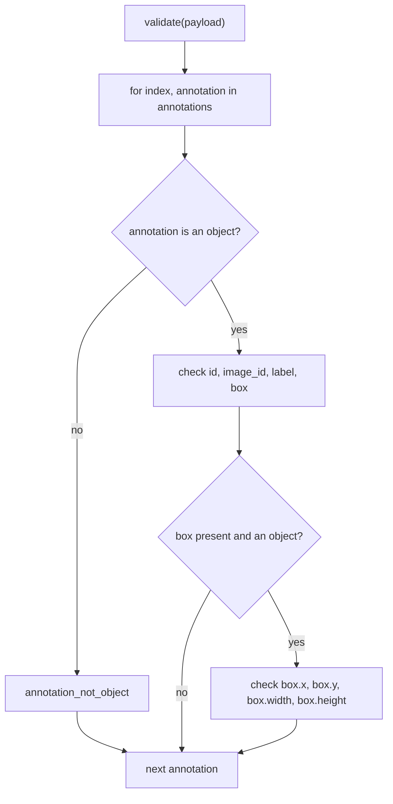

# Type Validation Rules - Plan

## Goal Capsule

- **Objective:** Someone submitting an import file gets one actionable error for every structural problem in its annotations: a missing field, or a field of the wrong type. Each error identifies the record and says what the field should be and what it actually holds.
- **Means:** A new type-rules module with one check per field, called once per annotation by `validate()` (KTD1, KTD2).
- **Product authority:** This plan covers type rules T1–T6 from `docs/data-rules.md` only. Content rules (C1–C7), the AutoQA rule (Q1) and warnings are not active scope.
- **Execution profile:** Two units, U1 then U2; standard library only; existing `unittest` suite.
- **Stop conditions:** Stop and ask if a fixture record's actual errors contradict an Acceptance Example, or if any requirement would need an external dependency.
- **Open blockers:** None.

---

## Product Contract

**Product Contract preservation:** Product Contract unchanged; the two Outstanding Questions are resolved in place by KTD3 and KTD5.

### Summary

`validate()` checks every annotation against type rules T1–T6 and returns one error per problem, in file order. Each error carries the record's 0-based `index`, and a message naming the record, the field, the expected type, and the value actually found. A record that isn't an object, or a `box` that isn't one, produces a single error, not a cascade of errors from the fields inside it.

### Problem Frame

`POST /validate-annotations` returns the typed response from stage 2, but `validate()` still returns an empty list for every file. Both provided fixtures contain structural problems that importers really make: `extended-import.json` has 21 annotations that break type rules, and even `sample-import.json` has two (record 4 has no `label`, record 8 has `box.x: "10"`). Today the user gets no hint that anything is wrong.

The README's deliverable is a report that lets a user "locate an invalid record, understand the problem, and determine what to change". Type rules come first because content rules depend on them: a rule like "the box fits inside its image" can't run on a `box.x` that is a string.

### Key Decisions

- **Hand-written checks, no schema library.** Governs R1. (session-settled: user-directed — chosen over a generic walker driven by `TypedDict` or dataclass field types: the format is small, and plain checks keep full control of each message)
- **Content rules will later skip only the fields that failed type checks, not the whole record.** A user then sees every problem in one pass. Governs R8. (session-settled: user-directed — chosen over skipping all content rules for a record with any type error, and over independent rules that each re-check types: per-record skipping hides problems until a second import)
- **Messages show the expected type and what was found, value included and never shortened.** Governs R6. (session-settled: user-directed — chosen over naming only the expected type, and over naming the found type without its value; shortening long values was proposed and rejected)
- **`index` is 0-based and sent in the response.** Governs R5. (session-settled: user-directed — chosen over 1-based and over an internal-only field: tests and the front-end can match an error to its record without parsing the message)
- **Finiteness is a content rule.** `NaN`, `Infinity` and `-Infinity` are numbers for T6, and C2/C3 will reject them later. Governs R1. (session-settled: user-directed — chosen over treating non-finite values as the wrong type)
- **Missing and wrong type are separate errors, and `null` counts as present with the wrong type.** Users need a different fix for each case. Governs R2. (session-settled: user-approved — proposed in the scoping synthesis and confirmed)
- **Nested structure stops at the first non-object.** One bad container gives one error. Governs R3. (session-settled: user-approved — proposed in the scoping synthesis and confirmed)
- **The top-level shape is assumed well-formed.** It isn't relevant to this prototype. Governs R9. (session-settled: user-directed — chosen over adding a top-level type rule)

### Requirements

**Rules checked**

- R1. Every annotation is checked against type rules T1–T6 as defined in `docs/data-rules.md`.
- R2. A missing field and a field holding the wrong type are reported as different errors with different codes; a field whose value is `null` is present with the wrong type.
- R3. An annotation that is not an object produces one error and no other type errors; a `box` that is missing or not an object produces one error and no errors for `box.x`, `box.y`, `box.width` or `box.height`.
- R4. Every type error found is reported, in the order the annotations appear in the file, with several errors allowed on one annotation.

**What each error says**

- R5. Each error's `index` is the annotation's 0-based position in `annotations`.
- R6. Each message names the annotation by its 1-based position, names the field (`box.x` for a box field), states the expected type, and states what was found: its JSON type and its value written as it appears in JSON (`true`, `null`, `"10"`), never shortened.
- R7. Each error carries a stable code that identifies both the field and whether it was missing or the wrong type.

**Boundaries with later work**

- R8. Type checks are made per field, so that the content rules added later can skip exactly the fields that failed.
- R9. Requests whose top level is not an object with an `annotations` list are outside this work, and may fail without a validation report.

### Acceptance Examples

- AE1. **Covers R1, R6.** **Given** annotation 47 has `"box": {"x": true, ...}`, **when** the file is validated, **then** there is one error with `index` 47, and its message names annotation #48 and `box.x` and says it must be a number but is a boolean, `true`.
- AE2. **Covers R2, R3.** **Given** annotation 62 is `{}`, **when** the file is validated, **then** there are exactly four "missing" errors with `index` 62 (`id`, `image_id`, `label`, `box`), and none for `box`'s own fields.
- AE3. **Covers R3.** **Given** annotation 42 has `"box": [10, 10, 20, 20]`, **when** the file is validated, **then** there is one error saying `box` must be an object but is an array, and no errors for `box.x` through `box.height`.
- AE4. **Covers R3.** **Given** annotation 58 is `null`, **when** the file is validated, **then** there is exactly one error with `index` 58, saying the annotation must be an object but is `null`.
- AE5. **Covers R2.** **Given** annotation 37 has `"label": null`, **when** the file is validated, **then** its error is the wrong-type error for `label`, not the missing-field error.
- AE6. **Covers R1.** **Given** a box field holding `NaN` or `Infinity`, **when** the file is validated, **then** no type error is reported for it.
- AE7. **Covers R1, R4, R5.** **Given** `test/fixtures/sample-import.json`, **when** it is POSTed, **then** the response holds exactly two errors, in this order: `label` missing at `index` 4, then `box.x` wrong type (a string, `"10"`) at `index` 8.

### Success Criteria

- `test/fixtures/extended-import.json` reports a type error for each of its 21 structurally broken annotations, and none for the structurally valid ones. Its content-rule problems (unknown `image_id`, out-of-bounds boxes and similar) produce no errors yet.

### Scope Boundaries

- Deferred to the next stage: content rules C1–C7, including finiteness and the "fits inside the image" check, plus the per-field pass/fail result they will consume (R8).
- Deferred: the AutoQA rule Q1 and warnings.
- Deferred: a per-record valid/invalid summary in the response. The README asks the report to distinguish valid from invalid records; for now that can be derived from which `index` values have errors.
- Not built: checking the top-level shape (R9).
- Not built: validating `images`, `allowed_labels` or `label_subsets`, which are trusted per `docs/data-rules.md`.

### Sources / Research

- `docs/data-rules.md`: type rules T1–T6, and the content and AutoQA rules this work leaves for later.
- `test/fixtures/extended-import.json`: annotations 29, 31, 32, 34, 35, 37, 38, 40–48, 58–62 break type rules; 62 (`{}`) breaks four at once; 58–60 are not objects (`null`, a string, an array).
- `test/fixtures/sample-import.json`: annotation 4 has no `label`; annotation 8 has `box.x: "10"`.
- `docs/plans/2026-11-08-1718-feat-validation-response-shape-plan.md`: the response shape (`code`, `message`, `index`) and the ordering and naming rules this work fills in.

---

## Planning Contract

### Key Technical Decisions

- KTD1. **Type rules live in a new `annotation_validator/type_rules.py`, and `validate()` stays a loop.** `validate()` walks `payload["annotations"]` with `enumerate` and concatenates each annotation's type errors, which keeps file order (R4) and makes the 0-based `index` free (R5). The content-rules stage will add a sibling module rather than growing this one. Implements R1, R4, R5.
- KTD2. **One small helper checks a single field, called explicitly once per field.** The helper takes the container, the key, the expected JSON type, the annotation's index and the field's display name. It returns no error, a missing-field error, or a wrong-type error. The eight calls are written out in a fixed order: `id`, `image_id`, `label`, `box`, then `box.x`, `box.y`, `box.width`, `box.height`. This is plain code, not a schema walker (per the hand-written-checks Key Decision), and it gives R8 its per-field structure. The `box.*` calls run only when `box` is present and an object (R3).
- KTD3. **Codes are `annotation_not_object`, `<field>_missing` and `<field>_wrong_type`**, where `<field>` replaces dots with underscores (`box_x_wrong_type`). The message templates are:
  - missing: `Annotation #5: label is missing. It must be a string.`
  - wrong type: `Annotation #48: box.x must be a number, but it is a boolean (true).`
  - wrong type, `null`: `Annotation #38: label must be a string, but it is null.`
  - not an object: `Annotation #59 must be an object, but it is a string ("not-an-annotation-object").`

  The position in the message is `index + 1`. Implements R6, R7.
- KTD4. **Found values are described by their JSON type and their JSON text.** Type names are `null`, `boolean`, `number`, `string`, `array` and `object`, with "a"/"an" as needed. The value is `json.dumps(value, ensure_ascii=False)`, so it shows `true`, `null` and `"10"` in full, with no shortening. `bool` is tested before the number check, so `true` is a boolean, not a number; "number" means `int` or `float` excluding `bool`, so `NaN` and `Infinity` pass T6 (AE6). Implements R2, R6.
- KTD5. **Tests split by layer.** `test/test_type_rules.py` (new) covers the per-annotation checks with small hand-built records. `test/test_validate.py` checks both fixtures through `validate()`: the sample's exact two errors, and the extended fixture's exact set of record indices with errors. `test/test_server.py` checks the sample's exact errors over HTTP and no longer posts the extended fixture.

### High-Level Technical Design

How one annotation is checked (directional):

### Assumptions

- The request's top level is an object with an `annotations` list (R9). Anything else may raise inside `validate()` and drop the connection.

---

## Implementation Units

### U1. Per-annotation type checks

- **Goal:** A function that returns every type error for one annotation, with codes, messages and `index` per R2–R7.
- **Requirements:** R1, R2, R3, R5, R6, R7, R8; KTD2, KTD3, KTD4; AE1–AE6.
- **Dependencies:** None.
- **Files:**
  - `annotation_validator/type_rules.py` (new)
  - `test/test_type_rules.py` (new)
- **Approach:**
  1. Add the JSON-type-name and value-rendering helpers per KTD4.
  2. Add the single-field helper per KTD2, returning a list of zero or one `ValidationError`.
  3. Add the per-annotation function: the not-an-object short-circuit, the four top-level fields, then the box fields only when `box` is a present object.
- **Execution note:** Write the test scenarios first and watch them fail on the missing module.
- **Patterns to follow:** `ValidationError` in `annotation_validator/response.py`; `subTest` loops as in `test/test_validate.py`.
- **Test scenarios:**
  - A fully valid annotation returns no errors.
  - Covers AE1. `box.x` of `true` at index 47 returns one error: code `box_x_wrong_type`, `index` 47, message `Annotation #48: box.x must be a number, but it is a boolean (true).`
  - Covers AE2. `{}` at index 62 returns exactly `id_missing`, `image_id_missing`, `label_missing`, `box_missing`, in that order, all with `index` 62.
  - Covers AE3. `box` of `[10, 10, 20, 20]` returns one `box_wrong_type` error naming an array, and no `box_*` field errors.
  - Covers AE4. An annotation of `null`, of a string, and of a list each return exactly one `annotation_not_object` error.
  - Covers AE5. `label` of `null` returns `label_wrong_type` with message ending `but it is null.`, not `label_missing`.
  - Covers AE6. `box.width` of `float("nan")` and `box.x` of `float("inf")` return no errors.
  - `id` of `33` returns `id_wrong_type` naming a number (`33`).
  - `box.x` of `"10"` returns `box_x_wrong_type` naming a string (`"10"`).
  - `box` missing `x` returns `box_x_missing` only.
  - Two problems on one record (`id` missing and `box.height` of `false`) return both errors, in field order.
- **Verification:** The new tests pass; nothing in `annotation_validator/` imports outside the standard library.

### U2. Run type checks from `validate()` and update fixture tests

- **Goal:** `validate()` returns the type errors for every annotation in file order, and the fixture and server tests expect real errors.
- **Requirements:** R1, R4, R5, R9; KTD1, KTD5; AE7; Success Criteria.
- **Dependencies:** U1.
- **Files:**
  - `annotation_validator/validate.py`
  - `test/test_validate.py`
  - `test/test_server.py`
- **Approach:**
  1. Replace the placeholder body of `validate()` with the loop per KTD1.
  2. Replace the fixture test in `test/test_validate.py` with the sample and extended expectations below.
  3. In `test/test_server.py`, replace the fixtures test with the sample check below, and remove the `assert_errors_empty` helper if nothing else uses it.
- **Execution note:** Update the fixture tests first and watch them fail against the placeholder, which returns `[]`.
- **Patterns to follow:** The `post` helper and the `ServerTest` fixture in `test/test_server.py`.
- **Test scenarios:**
  - Covers AE7. `validate()` on `sample-import.json` returns exactly two errors, in order: `label_missing` at `index` 4, then `box_x_wrong_type` at `index` 8.
  - The set of `index` values with errors for `extended-import.json` is exactly {29, 31, 32, 34, 35, 37, 38, 40, 41, 42, 43, 44, 45, 46, 47, 48, 58, 59, 60, 61, 62}, and record 62 has four errors.
  - Errors from `validate()` are in non-decreasing `index` order for the extended fixture.
  - Covers AE7. POSTing `sample-import.json` returns 200, `application/json`, and a body whose `errors` list holds those two errors with their `code`, `index` and message.
- **Verification:** The full suite passes, and a curl POST of the sample fixture shows the two errors.

---

## Verification Contract

| Check | Command or action | Proves |
|---|---|---|
| Unit and server tests | `python3 -m unittest discover -s test` from the repo root | U1, U2, AE1–AE7 |
| Manual smoke | Run `python3 -m annotation_validator.server`, then `curl -s -X POST --data-binary @test/fixtures/sample-import.json http://127.0.0.1:8000/validate-annotations` | R6 on a real server: two readable errors |
| Dependency check | No new imports outside the standard library | The no-external-dependencies constraint |

---

## Definition of Done

- U1 and U2 are complete, and every test scenario above exists and passes.
- Both fixtures produce exactly the errors in U2's scenarios.
- No content-rule, AutoQA or top-level checks were added.
- No external dependencies were added.
- Code from abandoned approaches is removed from the diff.
