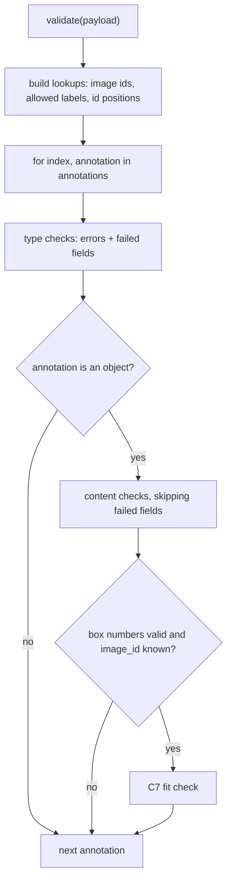

# Content Validation Rules - Plan

## Goal Capsule

- **Objective:** Someone submitting an import file gets one actionable error for every annotation whose values are wrong, not just mistyped. This covers an empty or reused id, an unknown image or label, box numbers that are negative, zero or non-finite, and a box that doesn't fit its image. Each error identifies the record and says what the value should be and what it actually is.
- **Means:** Content rules sit in their own stage, next to the type rules, and `validate()` runs types first, then content (R1).
- **Product authority:** This plan covers content rules C1–C7 from `docs/data-rules.md`. Type rules T1–T6 are already built. The AutoQA rule (Q1), warnings, and a per-record valid/invalid summary are not active scope.
- **Execution profile:** Three units, U1 to U3 in order; standard library only; existing `unittest` suite.
- **Stop conditions:** Stop and ask if a fixture record's actual errors contradict U3's expected lists, or if any requirement would need an external dependency.
- **Open blockers:** None.

---

## Product Contract

**Product Contract preservation:** Product Contract unchanged; its two Deferred-to-Planning questions are resolved by KTD2 and KTD3 and removed from Outstanding Questions.

### Summary

`validate()` reports content errors (C1–C7) alongside the existing type errors. A content rule skips only the fields that failed a type check, so one bad field doesn't hide problems in the others. A reused id is reported on every record that shares it. A box that overflows its image gets one error that shows the box and the image size.

### Problem Frame

Since stage 3, the endpoint catches missing and mistyped fields. A record can still pass every type check and be wrong:

- its `image_id` names an image that isn't in the request;
- its `label` isn't allowed;
- its id is empty or used twice;
- its box has a negative, zero or infinite number, or hangs off the edge of its image.

Today none of these is reported, so the user believes the file is clean. The README asks for a report that lets a user "locate an invalid record, understand the problem, and determine what to change", and these are the problems importers most often need to fix by hand. `extended-import.json` contains examples of each.

### Key Decisions

- **Content rules are a separate stage beside the type rules, not mixed into them.** Content rules need request-wide context (other ids, `images`, `allowed_labels`) that type rules don't, and they depend on type results, never the reverse. Governs R1. (session-settled: user-directed — chosen over adding content checks into the type-rule checks: keeping them apart keeps the type→content dependency in one place and mirrors the T/C split in `docs/data-rules.md`)
- **Every record sharing a duplicated id gets an error.** The file doesn't say which one is "right", so the user sees the whole collision and picks. Governs R6. (session-settled: user-directed — chosen over erroring only the later occurrences, and over one shared error with no single owning record)
- **A box that doesn't fit gets one general error, not an error per edge.** Governs R9. (session-settled: user-directed — chosen over one error naming each overflowing edge with its arithmetic, and over one error per edge)
- **An empty id is not also a duplicate.** Two records with `""` each get only the empty-id error. Governs R5, R6. (session-settled: user-approved — proposed in the scoping synthesis and confirmed: one fix, one error)
- **An unknown-label error lists every allowed label, in full.** This follows the stage-3 rule that values are never shortened, and tells the user exactly what to change. Governs R8. (session-settled: user-approved — proposed in the scoping synthesis and confirmed)
- **Carried forward from stage 3:** content rules skip only the fields that failed type checks (session-settled: user-directed — chosen over skipping the whole record, and over each rule re-checking types); finiteness is a content rule (session-settled: user-directed — chosen over treating non-finite values as the wrong type); messages show what was expected and what was found, never shortened, with a 0-based `index` (session-settled: user-directed). Governs R2, R4, R10.

### Requirements

**How content rules run**

- R1. Content rules C1–C7, as defined in `docs/data-rules.md`, run as a separate stage after the type rules, on every annotation that is an object.
- R2. A content rule is skipped for a field only when that field failed a type check. The rest of the record is still checked.
- R3. Errors stay in file order across both stages (non-decreasing `index`), and one record may have several content errors.

**Rules on one value**

- R4. A `box.x` or `box.y` that is negative or non-finite, or a `box.width` or `box.height` that is zero, negative or non-finite, gets its own error per field (C2, C3).
- R5. An empty `id` gets an error (C1).

**Rules against other data**

- R6. When two or more annotations share a non-empty `id`, each of them gets an error naming the positions of the others (C4).
- R7. An `image_id` that matches no entry in `images` gets an error (C5).
- R8. A `label` that doesn't exactly match an entry in `allowed_labels` gets an error listing every allowed label. Matching is case-sensitive, with no trimming (C6).
- R9. A box that doesn't fit inside its image gets one error showing the box's values and the image's width and height (C7). C7 runs only when all four box numbers pass type checks and C2/C3, and the `image_id` passes C5.

**What each error says**

- R10. Each content error follows the stage-3 pattern: a stable code for the rule and field, the 0-based `index`, and a message giving the 1-based position, the field, what the value must be, and the value found.

### Acceptance Examples

- AE1. **Covers R6, R5.** **Given** the annotations at indices 3, 7 and 12 all have id `"ann-7"`, and those at indices 20 and 21 both have id `""`, **when** the file is validated, **then** 3, 7 and 12 each get a duplicate-id error naming the other two positions, and 20 and 21 each get only an empty-id error.
- AE2. **Covers R9.** **Given** a box `x 1200, y 10, width 100, height 50` on an image that is 1280×720, **when** the file is validated, **then** there is exactly one error for the box, showing those four values and `1280×720`.
- AE3. **Covers R9.** **Given** a box with `x + width` exactly equal to the image width, **when** the file is validated, **then** there is no C7 error, because touching the edge is valid.
- AE4. **Covers R9, R7.** **Given** an annotation whose `image_id` matches no image and whose box is otherwise valid, **when** the file is validated, **then** it gets the unknown-image error and no fit error.
- AE5. **Covers R2, R4.** **Given** an annotation with `label: null` and `box.width: -5`, **when** the file is validated, **then** it gets the stage-3 label wrong-type error, plus a width error from C3, and no C6 label error.
- AE6. **Covers R4.** **Given** `box.x` is `NaN` and `box.height` is `Infinity`, **when** the file is validated, **then** each gets its own non-finite error, and C7 does not run for that box.
- AE7. **Covers R8.** **Given** `allowed_labels` is `["car", "person"]` and an annotation's label is `"Car"`, **when** the file is validated, **then** its error says the label must be one of `"car"`, `"person"` and shows `"Car"`.

### Success Criteria

- Both fixtures produce an exact, test-pinned set of content errors, alongside their existing type errors. Every content problem in `extended-import.json` is reported, and records that break no rule get no errors.

### Scope Boundaries

- Deferred: AutoQA rule Q1 and warnings. Q1 will later treat a record as valid when it has no type or content errors.
- Deferred: a per-record valid/invalid summary in the response.
- Not built: overlap checks between boxes (the README says not to).
- Not built: validating `images`, `allowed_labels` or `label_subsets`, which are trusted.
- Not built: checking the request's top-level shape.

### Sources / Research

- `docs/data-rules.md`: content rules C1–C7, the C7 dependency on T6/C2/C3/C5, and the trusted-input assumptions.
- `docs/plans/2026-11-08-1809-feat-type-validation-rules-plan.md`: the stage-3 message pattern, codes, and per-field gating this work builds on.
- `annotation_validator/type_rules.py`, `annotation_validator/validate.py`: the current type stage and the `validate()` loop the content stage joins.

---

## Planning Contract

### Key Technical Decisions

- KTD1. **Content rules live in a new `annotation_validator/content_rules.py`, and `validate()` runs both stages per annotation.** `validate()` first builds the request-wide lookups the content stage needs (image ids, allowed labels, the positions of each non-empty string id), then for each annotation appends its type errors and then its content errors. This keeps every error in non-decreasing `index` order (R3). Implements R1, R3.
- KTD2. **The type stage reports which fields failed, alongside its errors.** `check_annotation_types` returns both its errors and the set of field names that failed (`id`, `image_id`, `label`, `box`, `box.x` … `box.height`). The content stage reads that set and never parses error codes, so renaming a code can't silently change gating. A non-object annotation has no content checks at all. Implements R2.
- KTD3. **Within one record, content errors follow field order.** The order is C1/C4 on `id`, C5 on `image_id`, C6 on `label`, C2/C3 on `box.x`, `box.y`, `box.width`, `box.height`, then C7 last. Implements R3.
- KTD4. **Codes and messages follow the stage-3 pattern (R10).** Values are written with `json.dumps(value, ensure_ascii=False)`, so `NaN`, `-5` and `"Car"` appear exactly as in JSON, never shortened. Templates:
  - `id_empty`: `Annotation #31: id must not be empty.`
  - `id_duplicate`: `Annotation #4: id "ann-7" is also used by annotations #8 and #13. Each id must be unique.` With one other position it reads `is also used by annotation #8.`; with three or more, `by annotations #8, #13 and #20.`
  - `image_id_unknown`: `Annotation #3: image_id "frame-missing" does not match any image.`
  - `label_not_allowed`: `Annotation #4: label "unsupported-label" is not allowed. It must be one of: "instrument", "grasper", "tissue", "organ", "reference_marker".`
  - `box_<field>_not_finite`: `Annotation #6: box.x must be a finite number, but it is NaN.`
  - `box_<x|y>_negative`: `Annotation #6: box.x must be 0 or greater, but it is -5.`
  - `box_<width|height>_not_positive`: `Annotation #7: box.width must be greater than 0, but it is 0.`
  - `box_out_of_bounds`: `Annotation #8: box (x 180, y 80, width 30, height 20) does not fit inside image "frame-002" (width 200, height 100).`

  Non-finite is checked before sign, so `-Infinity` reports as not finite. Implements R4–R10.
- KTD5. **C4 counts only ids that passed T2 and C1.** A mistyped or empty id is never part of a duplicate group (the empty-id Key Decision). The duplicate message lists the other positions in file order. Implements R5, R6.
- KTD6. **Tests split by layer, as in stage 3.** `test/test_content_rules.py` (new) checks single annotations against hand-built lookups. `test/test_validate.py` pins both fixtures' exact `(code, index)` lists. `test/test_server.py` pins the sample's full JSON response. Implements Success Criteria.

### High-Level Technical Design

How one request is checked:

### Assumptions

- Work starts from the type-rules branch (PR #3) or from `main` once that PR merges, since U1 changes `annotation_validator/type_rules.py`.
- The request's top level is an object with `images`, `allowed_labels` and an `annotations` list (out of scope per Scope Boundaries).

---

## Implementation Units

### U1. Type stage reports failed fields

- **Goal:** `check_annotation_types` returns its errors together with the set of failed fields (KTD2), with no change to the errors themselves.
- **Requirements:** R2; KTD2.
- **Dependencies:** None.
- **Files:**
  - `annotation_validator/type_rules.py`
  - `annotation_validator/validate.py` (reads `.errors` until U3)
  - `test/test_type_rules.py`
- **Approach:**
  1. Return a small frozen result holding the error list and the failed-field set. A field counts as failed when it is missing or the wrong type. When `box` fails, its four sub-fields are not listed separately, because their checks never ran.
  2. Update existing tests to read the errors from the result. Their expectations don't change.
- **Patterns to follow:** frozen dataclasses in `annotation_validator/response.py`.
- **Test scenarios:**
  - A valid annotation has no errors and no failed fields.
  - `box.x` of `true` lists `box.x` as failed and nothing else.
  - `{}` lists `id`, `image_id`, `label`, `box` as failed.
  - `box` as an array lists `box` only.
- **Verification:** The full suite passes with the same error output as before.

### U2. Content rules C1–C7

- **Goal:** A function that returns every content error for one object annotation, given its index, the failed-field set from U1, and the request lookups (KTD1).
- **Requirements:** R1, R2, R4–R10; KTD3, KTD4, KTD5; AE1–AE7.
- **Dependencies:** U1.
- **Files:**
  - `annotation_validator/content_rules.py` (new)
  - `test/test_content_rules.py` (new)
- **Approach:**
  1. Checks follow KTD3's order, and each skips a field listed as failed.
  2. C7 runs only when all four box numbers passed both their type check and C2/C3, and C5 passed. Touching the right or bottom edge is valid (R9).
  3. Lookups arrive ready-made: image dimensions by id, the allowed-label list in its given order, and id → positions for ids that passed T2 and C1 (KTD5).
- **Execution note:** Write the scenarios first and watch them fail on the missing module.
- **Patterns to follow:** `annotation_validator/type_rules.py`; the `subTest` style and `build_annotation`/`build_box` helpers in `test/test_type_rules.py`.
- **Test scenarios:**
  - A valid annotation on a known image, inside its bounds, returns no errors.
  - Covers AE1. Indices 3, 7 and 12 sharing `"ann-7"` each get `id_duplicate` naming the other two positions. Indices 20 and 21 with `""` each get only `id_empty`.
  - A pair sharing one id names the single other position in KTD4's one-position form.
  - Covers AE2. Box `x 1200, y 10, width 100, height 50` on a 1280×720 image returns one `box_out_of_bounds` with KTD4's message.
  - Covers AE3. `x + width` equal to the image width returns no error, and the same holds for `y + height`.
  - Covers AE4. An unknown `image_id` returns `image_id_unknown` and no `box_out_of_bounds`.
  - Covers AE5. `label` failed type (in the failed set) and `box.width: -5` return only `box_width_not_positive`.
  - Covers AE6. `box.x` NaN and `box.height` Infinity return `box_x_not_finite` and `box_height_not_finite`, and no fit check.
  - Covers AE7. Label `"Car"` with allowed `["car", "person"]` returns `label_not_allowed` listing `"car", "person"` and showing `"Car"`.
  - `box.y` of `-1` returns `box_y_negative`. `box.height` of `0` returns `box_height_not_positive`.
  - `box.x` of `-Infinity` returns `box_x_not_finite`, not `box_x_negative`.
  - Several problems on one record (`image_id` unknown and `box.width` 0) return both, in KTD3 order.
- **Verification:** The new tests pass, and `annotation_validator/` imports only the standard library.

### U3. Run content checks from `validate()` and update fixture tests

- **Goal:** `validate()` returns type and content errors for every annotation, per KTD1, and the fixture and server tests pin the new output.
- **Requirements:** R1, R3; KTD1, KTD6; Success Criteria.
- **Dependencies:** U1, U2.
- **Files:**
  - `annotation_validator/validate.py`
  - `test/test_validate.py`
  - `test/test_server.py`
- **Approach:**
  1. Build the lookups once per request, then loop as KTD1 describes.
  2. Replace the fixture expectations with the exact lists below.
- **Execution note:** Update the fixture tests first and watch them fail against the type-only `validate()`.
- **Patterns to follow:** the existing fixture tests in `test/test_validate.py` and the `post` helper in `test/test_server.py`.
- **Test scenarios:**
  - `sample-import.json` returns exactly, in order: `image_id_unknown`@2, `label_not_allowed`@3, `label_missing`@4, `box_x_negative`@5, `box_width_not_positive`@6, `box_out_of_bounds`@7, `box_x_wrong_type`@8.
  - `extended-import.json` returns errors on exactly the stage-3 index set {29, 31, 32, 34, 35, 37, 38, 40–48, 58–62}, plus the content set {30, 33, 36, 39, 49–57}. Indices are non-decreasing.
  - `extended-import.json` content codes are exactly: `id_empty`@30, `image_id_unknown`@33, `label_not_allowed`@36 and @39, `box_x_negative`@49 and @57, `box_y_negative`@50, `box_width_not_positive`@51 and @53, `box_height_not_positive`@52 and @54, `box_out_of_bounds`@55 and @56.
  - POSTing `sample-import.json` returns 200, `application/json`, and the seven errors with their codes, indices and full messages.
- **Verification:** The full suite passes, and a curl POST of the sample fixture shows all seven errors.

---

## Verification Contract

| Check | Command or action | Proves |
|---|---|---|
| Unit and server tests | `python3 -m unittest discover -s test` from the repo root | U1–U3, AE1–AE7 |
| Manual smoke | Run `python3 -m annotation_validator.server`, then `curl -s -X POST --data-binary @test/fixtures/sample-import.json http://127.0.0.1:8000/validate-annotations` | R10 on a real server: seven readable errors |
| Dependency check | No new imports outside the standard library | The no-external-dependencies constraint |

---

## Definition of Done

- U1–U3 are complete, and every test scenario above exists and passes.
- Both fixtures produce exactly the errors in U3's scenarios.
- No AutoQA, warning, or top-level checks were added.
- No external dependencies were added.
- Code from abandoned approaches is removed from the diff.
