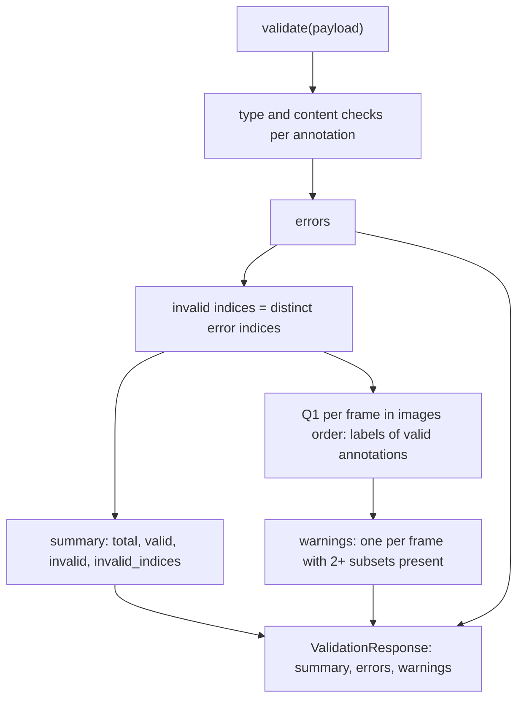

# AutoQA Label Subsets - Plan

## Goal Capsule

- **Objective:** Someone preparing an import can see at a glance which records are valid and which are not, and is told about every frame whose valid annotations mix labels from subsets that shouldn't appear together, so they know which frames to review.
- **Means:** A final AutoQA stage (Q1) runs after the type and content stages and adds warnings, and the response gains a valid/invalid summary.
- **Product authority:** This plan covers AutoQA rule Q1 from `docs/data-rules.md` and the brief's "distinguishes valid from invalid records" deliverable. Type rules T1–T6 and content rules C1–C7 are already built and are not changed.
- **Execution profile:** Two units, U1 then U2; standard library only; existing `unittest` suite.
- **Stop conditions:** Stop and ask if a fixture's actual summary or warnings contradict U1's or U2's expected values, or if any requirement would need an external dependency.
- **Open blockers:** None.

---

## Product Contract

**Product Contract preservation:** Product Contract unchanged.

### Summary

After the type and content checks, a final AutoQA stage looks at each frame's valid annotations. It returns one warning per frame whose labels come from two or more configured subsets. Warnings are a separate list from errors. The response also gains a summary: the total number of records, how many are valid and invalid, and the indices of the invalid ones.

### Problem Frame

The validator now reports every type and content problem, but two gaps remain against the brief. First, records can pass every check and still put mutually exclusive labels in one frame, such as `instrument` with `tissue`. The brief asks for that to be flagged as a warning so a person reviews it, and today nothing flags it. Second, the brief's minimum deliverable is a report that "distinguishes valid from invalid records". Today that is only implied: a record is invalid when some error carries its index, and a frontend has to work that out.

Both fixtures exercise Q1. `extended-import.json` has four `mixed-subsets-*` frames that should warn, and three `single-subset-*` frames that would wrongly warn if invalid records were counted.

### Key Decisions

- **AutoQA is a third stage that runs after the type and content stages and reads their results.** Q1 counts only valid annotations, so it needs both earlier stages' outcomes, and neither earlier stage reads AutoQA's. Governs R1, R2. (session-settled: user-approved — proposed with the fixture evidence that counting invalid records would add false warnings on `frame-002` and the three `single-subset-*` frames, and confirmed)
- **One warning per frame, not one per annotation.** A conflict belongs to the frame. No single record is wrong, and one warning per record would turn one problem into several. Governs R4. (session-settled: user-directed — chosen over one warning per involved annotation and over per-frame warnings that list annotation indices)
- **A warning's details live in its message.** A warning carries a code, the frame's `image_id` and a message, like errors carry theirs. The conflicting subsets and labels are not separate fields. Governs R5. (session-settled: user-directed — chosen over also adding structured fields for each conflicting subset and its observed labels)
- **The response states which records are valid.** The brief's deliverable is met by an explicit summary, not left for a frontend to derive from error indices. Governs R7. (session-settled: user-directed — chosen over leaving validity implicit in the errors list)
- **One definition of "valid".** A record is valid when no type or content error carries its index. The summary and Q1 use this same definition, so they never disagree. Governs R2, R7.

### Requirements

**How AutoQA runs**

- R1. Q1 runs once per request, after all type and content checks, as its own stage.
- R2. Q1 considers only valid annotations: those with no type or content error.
- R3. Q1 behaves as `docs/data-rules.md` defines it. Each frame is checked on its own. A subset is present when any of its labels appears among the frame's valid annotations. Repeated labels count once, labels in no subset are ignored, and an empty `label_subsets` produces no warnings.

**Warnings**

- R4. Each frame where two or more subsets are present gets exactly one warning. Frames are taken in the order they appear in `images`.
- R5. A warning has a stable code, the frame's `image_id`, and a message. The message names the frame and every conflicting subset, and shows which observed labels made each subset present.
- R6. Warnings are a separate list in the response from errors, and never change the errors.

**Valid/invalid summary**

- R7. The response includes a summary with the total number of annotations, the number valid, the number invalid, and the sorted 0-based indices of the invalid ones.

### Acceptance Examples

- AE1. **Covers R3, R4.** **Given** subsets `[["instrument", "grasper"], ["tissue", "organ"]]` and one frame whose valid annotations have labels `instrument` and `tissue`, **when** the file is validated, **then** that frame gets one warning.
- AE2. **Covers R3.** **Given** the same subsets, **when** a frame's valid labels are `instrument` and `grasper`, or just `instrument`, or only labels in no subset, or none at all, **then** it gets no warning.
- AE3. **Covers R2.** **Given** a frame where the only `tissue` record has a box out of bounds and the other records are `instrument`, **when** the file is validated, **then** the frame gets no warning.
- AE4. **Covers R4, R5.** **Given** three subsets and one frame whose valid labels come from all three, **when** the file is validated, **then** it gets one warning naming all three subsets.
- AE5. **Covers R3.** **Given** `label_subsets` is `[]`, **when** a file with mixed labels is validated, **then** there are no warnings.
- AE6. **Covers R7.** **Given** `sample-import.json`, **when** it is validated, **then** the summary reports 13 total, 6 valid, 7 invalid, and invalid indices `[2, 3, 4, 5, 6, 7, 8]`.

### Success Criteria

- `sample-import.json` returns exactly one warning, for `frame-001`, and `frame-002` gets none. `extended-import.json` returns exactly four warnings, for `mixed-subsets-ab`, `mixed-subsets-ac`, `mixed-subsets-bc` and `mixed-subsets-abc`, in that order. No `single-subset-*` frame warns.
- `extended-import.json`'s summary reports 64 total, 30 valid and 34 invalid.
- The existing errors for both fixtures are unchanged.

### Scope Boundaries

- Not built: validating `label_subsets`, which is trusted configuration.
- Not built: listing annotation indices or structured subset fields on a warning (see Key Decisions).
- Not built: per-annotation warnings.
- Not built: checking the request's top-level shape. `label_subsets` is assumed present, like `images` and `allowed_labels`.

### Sources / Research

- The exercise brief's `README.md` (supplied outside this repo), "AutoQA rule: mutually exclusive label subsets" and "Minimum deliverables": the source of Q1 and of the valid/invalid deliverable.
- `docs/data-rules.md`: rule Q1, its behaviour list and examples, and the assumption that a frame is an entry in `images`.
- `docs/plans/2026-11-08-1841-feat-content-validation-rules-plan.md`: the stage pattern and message conventions this work extends.

---

## Planning Contract

### Key Technical Decisions

- KTD1. **`validate()` returns the whole report.** It returns a `ValidationResponse` holding the summary, errors and warnings, and the server serializes it directly. One function owns the response, so the summary, errors and warnings can never be computed from different inputs. Implements R1, R6, R7. (session-settled: user-approved — proposed in the plan scoping synthesis over adding a second report-building function beside `validate()`, and confirmed)
- KTD2. **The response gains two frozen types in `annotation_validator/response.py`.** `ValidationWarning` has `code`, `message` and `image_id`. `ValidationSummary` has `total`, `valid`, `invalid` and `invalid_indices`. `ValidationResponse` has `summary`, `errors` and `warnings`, in that order, so the JSON keys appear in that order. Implements R5, R6, R7.
- KTD3. **Validity comes from the errors themselves.** After the type and content loop, the invalid indices are the sorted, distinct `index` values of the errors. Every other annotation is valid. Both the summary and Q1 read this one set, which is how the shared definition of "valid" is enforced. Implements R2, R7.
- KTD4. **Q1 lives in a new `annotation_validator/qa_rules.py`.** It takes the payload and the invalid-index set and returns warnings. For each entry in `images`, in order, it collects the labels of that frame's valid annotations. It finds the configured subsets with at least one of those labels, keeping the subsets in their configured order, and warns when two or more are present. A valid annotation always has a known string `image_id` and an allowed string label (C5, C6), so Q1 needs no type checks. Implements R1–R4.
- KTD5. **Warning code and message.** The code is `label_subsets_conflict`. Values are written with `json.dumps(value, ensure_ascii=False)`, as in the earlier stages. Within each subset, observed labels are listed in the subset's own order:
  - Two subsets: `Frame "frame-001" has labels from 2 subsets that should not appear together: "instrument", "grasper" (subset ["instrument", "grasper"]) and "tissue" (subset ["tissue", "organ"]).`
  - Three or more: `… 3 subsets that should not appear together: "instrument" (subset ["instrument", "grasper"]), "tissue" (subset ["tissue", "organ"]) and "clip" (subset ["cautery", "clip"]).`

  Implements R5.

### High-Level Technical Design

How one request is checked (directional, not an implementation spec):

### Assumptions

- The request's top level holds `images`, `allowed_labels`, `label_subsets` and an `annotations` list (Scope Boundaries).

---

## Implementation Units

### U1. Response carries a summary and a warnings list

- **Goal:** `validate()` returns a `ValidationResponse` with a valid/invalid summary, the existing errors unchanged, and an empty warnings list (KTD1–KTD3).
- **Requirements:** R6, R7; KTD1, KTD2, KTD3; AE6.
- **Dependencies:** None.
- **Files:**
  - `annotation_validator/response.py`
  - `annotation_validator/validate.py`
  - `annotation_validator/server.py`
  - `test/test_response.py`
  - `test/test_validate.py`
  - `test/test_server.py`
- **Approach:**
  1. Add `ValidationWarning` and `ValidationSummary`, and give `ValidationResponse` the fields `summary`, `errors`, `warnings`.
  2. `validate()` runs the existing loop, derives the invalid indices from the errors, and returns the response with an empty warnings tuple.
  3. The server serializes `validate()`'s result instead of wrapping a list.
  4. Existing fixture tests read `.errors`; their expectations don't change. The existing `test/test_response.py` tests that build a `ValidationResponse` from errors alone are updated to pass a summary and warnings too.
- **Execution note:** Update the fixture and server tests first and watch them fail against the current `validate()`.
- **Patterns to follow:** the frozen dataclasses and `asdict` serialization already in `annotation_validator/response.py` and `annotation_validator/server.py`.
- **Test scenarios:**
  - Covers AE6. `sample-import.json` gives summary total 13, valid 6, invalid 7, invalid indices `[2, 3, 4, 5, 6, 7, 8]`.
  - `extended-import.json` gives total 64, valid 30, invalid 34, invalid indices 29–62.
  - A record with several errors (extended index 62, four errors) appears once in the invalid indices.
  - Both fixtures' errors are exactly as before.
  - `test/test_response.py`: a response with a summary, an error and a warning serializes to JSON with keys `summary`, `errors`, `warnings` in that order.
- **Verification:** The full suite passes.

### U2. AutoQA rule Q1

- **Goal:** `qa_rules.py` returns one warning per frame whose valid annotations span two or more subsets, and `validate()` puts those warnings in the response (KTD4, KTD5).
- **Requirements:** R1–R5; KTD3, KTD4, KTD5; AE1–AE5.
- **Dependencies:** U1.
- **Files:**
  - `annotation_validator/qa_rules.py` (new)
  - `annotation_validator/validate.py`
  - `test/test_qa_rules.py` (new)
  - `test/test_validate.py`
  - `test/test_server.py`
- **Approach:**
  1. Write the Q1 check per KTD4, building the message per KTD5.
  2. `validate()` passes the payload and the invalid-index set from U1 to it and stores the result as the response's warnings.
- **Execution note:** Write the Q1 scenarios first and watch them fail on the missing module.
- **Patterns to follow:** `annotation_validator/content_rules.py` for message building and `show()`; the `subTest` style in `test/test_content_rules.py`.
- **Test scenarios:** (subsets `[["instrument", "grasper"], ["tissue", "organ"]]` unless stated)
  - Covers AE1. One frame with valid `instrument` and `tissue` gives one `label_subsets_conflict` warning with that frame's `image_id` and KTD5's two-subset message.
  - Covers AE2. Frames whose valid labels are `instrument` + `grasper`, just `instrument`, only `reference_marker`, or none give no warning.
  - Covers AE3. A frame whose only `tissue` record is invalid (its index is in the invalid set) and whose other records are `instrument` gives no warning.
  - Covers AE4. Three subsets with one valid label from each in one frame give one warning naming all three, in KTD5's three-subset form.
  - Covers AE5. `label_subsets` of `[]` gives no warnings for a mixed frame.
  - Repeated labels: two `instrument` records and one `tissue` record list `"instrument"` once.
  - Separate frames: `instrument` in one frame and `tissue` in another give no warning.
  - Several conflicting frames give warnings in `images` order.
  - `sample-import.json` gives exactly one warning, for `frame-001`, with message `Frame "frame-001" has labels from 2 subsets that should not appear together: "instrument", "grasper" (subset ["instrument", "grasper"]) and "tissue" (subset ["tissue", "organ"]).`
  - `extended-import.json` gives exactly four warnings, for `mixed-subsets-ab`, `mixed-subsets-ac`, `mixed-subsets-bc` and `mixed-subsets-abc`, in that order. No `single-subset-*` frame warns.
  - POSTing `sample-import.json` returns 200 `application/json` with the full summary, the seven errors and the one warning.
- **Verification:** The full suite passes, and a POST of the sample fixture to a running server shows the summary, seven errors and one warning.

---

## Verification Contract

| Check | Command or action | Proves |
|---|---|---|
| Unit and server tests | `python3 -m unittest discover -s test` from the repo root | U1–U2, AE1–AE6, Success Criteria |
| Manual smoke | Run `python3 -m annotation_validator.server`, then `curl -s -X POST --data-binary @test/fixtures/sample-import.json http://127.0.0.1:8000/validate-annotations` | The summary, errors and warning on a real server |
| Dependency check | No new imports outside the standard library | The no-external-dependencies constraint |

---

## Definition of Done

- U1 and U2 are complete, and every test scenario above exists and passes.
- Both fixtures produce exactly the summaries and warnings in U1's and U2's scenarios, with their errors unchanged.
- The type and content rules are unchanged.
- No external dependencies were added.
- Code from abandoned approaches is removed from the diff.
